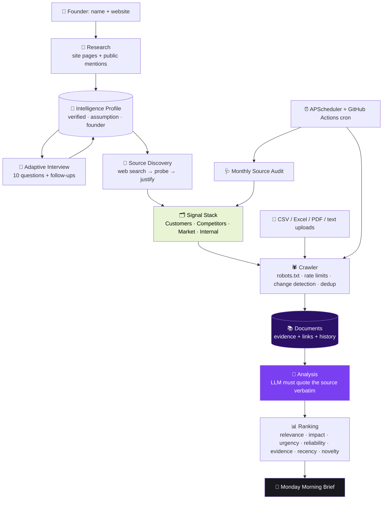

<div align="center">


<br>


<br>


</div>
<div align="center">

</div>

<div align="center">


[](#)
[](#)
[](samples/)

</div>
<br>

> **Signal Stack** turns a company into a continuously monitored, intelligent business. Enter a company name and website: it **researches** the business (separating verified facts from assumptions), runs an **adaptive 10-question founder interview**, **discovers and justifies** intelligence sources across **Customers, Competitors, Market and Internal** data, **crawls** them politely, **analyses and ranks** what changed, and writes an executive **Monday Morning Brief**, with every development linked to its source. Nothing about a company is hard-coded: a company it has never seen gets the same treatment.

<div align="center">

</div>

<div align="center">

</div>



**Key rule:** the LLM is an analyst, never a source. It only reads documents we collected, must copy an evidence quote word-for-word, and **code rejects any signal whose quote is not found in the stored text**. Verified facts and AI interpretation are stored in separate fields and shown separately.

<div align="center">

</div>

<div align="center">

</div>

| Stage | What happens | Guard-rail |
|---|---|---|
| 🔎 **Research** | Reads the homepage + up to 8 key pages, plus public search mentions | A "verified" fact must cite a fetched page **and** a quote found in it, otherwise it is downgraded to "assumption" |
| 💬 **Interview** | 10 core questions generated from the profile and previous answers, one at a time, with ≤4 follow-ups | Duplicate-question check; skip for confidential; answers editable later and re-extracted |
| 🧭 **Discovery** | Competitors from search + founder answers (second LLM pass rejects unrelated names); sources found by search, then probed | robots.txt, liveness, RSS detection and freshness are **measured**, not guessed; each source gets a reason + Specific / Recent / Credible scores |
| 🕷️ **Monitoring** | RSS, page-change diffs, competitor newsrooms/pricing/careers pages, news-index queries (DuckDuckGo/Bing News + GDELT) | Per-domain delay, no auth bypass, 401/403/429 respected, exact + near-duplicate detection, full check history |
| 🧠 **Analysis** | Batches of documents → signal / not signal; what happened, when, why it matters, area, type, urgency, action | Verbatim-quote verification; facts vs interpretation stored apart |
| 📊 **Ranking** | `25% relevance · 20% impact · 12% urgency · 15% source reliability · 10% evidence · 10% recency · 8% novelty` | Reliability, evidence strength and relevance are **separate measures**; corroboration across domains raises evidence; each rank has a written explanation |
| 📰 **Brief** | 10 required sections; category sections rendered straight from signals; LLM only synthesises | Every summary/opportunity/risk/action must cite existing signal IDs or it is dropped; empty sections say so |

<div align="center">

</div>

<div align="center">

</div>

| # | Section | Built from |
|:---:|---|---|
| 1 | Executive Summary (top 5) | LLM synthesis, each line cites signals |
| 2 | Customer Signals | Ranked customer signals |
| 3 | Competitor Intelligence | Ranked competitor signals (what changed, evidence, why it matters) |
| 4 | Market Intelligence | Regulatory / industry / economic / technology signals |
| 5 | Internal Business Intelligence | Insights from uploaded CRM / transcripts / reports |
| 6 | Opportunities Identified | Evidence, impact, next step, priority |
| 7 | Risks & Threats | Impact + urgency |
| 8 | Recommended Actions for This Week | Owner + priority, **trackable in the UI** |
| 9 | What We Should Watch | Early developments |
| 10 | Source Appendix | Source, link, published date, discovered date, snippet, verification + confidence |

Export: **Markdown**, **email-ready HTML**, copy to clipboard. Brief history is kept per company.

<div align="center">

</div>

<div align="center">

</div>

| Process | Default schedule | Steps |
|---|---|---|
| **A · Weekly Intelligence Brief** | Monday 07:00 (company time zone) | crawl approved sources → detect changes → analyse → rank → save brief |
| **B · Monthly Signal Stack Audit** | 1st of month | dead URLs · blocked · duplicates · inactive · declining relevance · new candidates → health report + add/remove recommendations |
| Monitoring crawl | every 24 h (configurable) | collect between briefs |

Both run in-process (APScheduler, per-company settings) **and** via a free GitHub Actions cron (`.github/workflows/scheduled-runs.yml`) because free hosts sleep. Every run, including missed and failed ones, is logged and shown in **Settings & Automation**. Briefs can also be triggered manually.

<div align="center">

</div>

<div align="center">

</div>

```bash
git clone https://github.com/<your-username>/signal-stack.git
cd signal-stack
```

### 🔧 Backend (Python 3.12+)
```bash
cd backend
python -m venv .venv
.venv/Scripts/activate        # Windows  (macOS/Linux: source .venv/bin/activate)
pip install -r requirements.txt
cp .env.example .env          # add your free GROQ_API_KEY and GEMINI_API_KEY
uvicorn app.main:app --port 8000
```

### 💻 Frontend
```bash
cd frontend
npm install
npm run dev                   # http://localhost:5173 (proxies /api to :8000)
```

### 🧪 Reproduce the demo
1. **Company Setup** → `MeetUniversity` · `https://www.meetuniversity.com`
2. **AI Interview** → answer the 10 questions (skip any confidential one)
3. **Signal Stack** → *Build Signal Stack*; approve/remove sources in **Source Manager**
4. **Run brief** (top bar) → read it in **Monday Brief**, export Markdown/HTML
5. Repeat for two companies from other industries; then change one company's context in **Intelligence Profile → Change business context**

<div align="center">

</div>

<div align="center">

</div>

| Part | Host | How |
|---|---|---|
| API | **Render** free web service | `render.yaml` blueprint (root `backend/`); set `GROQ_API_KEY`, `GEMINI_API_KEY`, `DATABASE_URL` |
| Database | **Neon** free Postgres | `postgresql+psycopg://…?sslmode=require` (Render free disks are not persistent) |
| Frontend | **Vercel** free | root `frontend/`, env `VITE_API_URL=https://<api>.onrender.com` |
| Scheduler | **GitHub Actions** | repo secrets `API_URL`, `CRON_TOKEN` |

<div align="center">

</div>

<div align="center">

</div>

```
backend/app/
  main.py            REST API (FastAPI)          models.py     schema (Signal → Document → Source)
  llm.py             Groq + Gemini, fallback     fetch.py      robots.txt, rate limits, extraction, quote check
  search.py          free web/news search        scheduler.py  weekly brief + monthly audit
  jobs.py            logged background jobs      pipelines.py  job bodies
  services/  research · interview · discovery · crawler · analysis · ranking · brief · internal · audit
frontend/src/
  pages/     Overview · Setup · Profile · Interview · Stack · Sources · Feed · Brief · Internal · Automation
docs/        TECHNICAL.md · COST.md · TEST_EVIDENCE.md
samples/     generated Monday briefs (Markdown)
```

<div align="center">

</div>

<div align="center">

</div>

- **Blocked by robots.txt, so skipped:** Reddit, Quora, LinkedIn, Google News RSS and some review sites. Customer-voice coverage is therefore thinner than it would be with paid/official APIs.
- **Free LLM quotas:** Groq ≈ 8k tokens/min, Gemini free-tier rate limits. Large runs queue, retry and fall back; a full first run takes several minutes.
- **News indexes** sometimes give only a headline/snippet when the publisher blocks crawlers; such signals are labelled *snippet only* and get lower reliability.
- **Scanned PDFs** need OCR (not included).

Full details: [`docs/TECHNICAL.md`](docs/TECHNICAL.md) · [`docs/COST.md`](docs/COST.md)

<div align="center">

</div>

<div align="center">

**Built by Tanish Aggarwal** · EDXSO AI Engineer Intern Assignment

UI visual language inspired by the *CRM UI Charts for SaaS Dashboards* Figma kit by David Sedláček (CC BY 4.0).

</div>

<div align="center">

</div>
